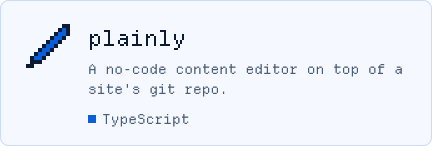
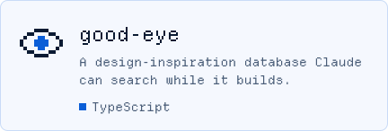
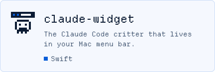
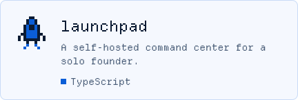
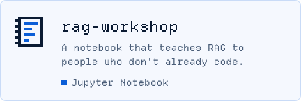
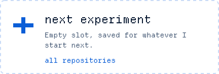
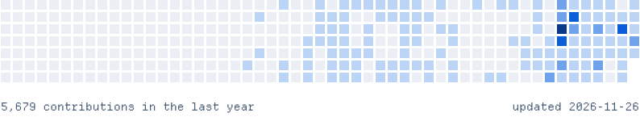

<a href="https://github.com/glebstarchikov/plainly"><picture><source media="(prefers-color-scheme: dark)" srcset="assets/card-plainly-dark.svg"></picture></a>
<a href="https://github.com/glebstarchikov/good-eye"><picture><source media="(prefers-color-scheme: dark)" srcset="assets/card-good-eye-dark.svg"></picture></a>
<a href="https://github.com/glebstarchikov/claude-widget"><picture><source media="(prefers-color-scheme: dark)" srcset="assets/card-claude-widget-dark.svg"></picture></a>
<a href="https://github.com/glebstarchikov/launchpad"><picture><source media="(prefers-color-scheme: dark)" srcset="assets/card-launchpad-dark.svg"></picture></a>
<a href="https://github.com/glebstarchikov/rag-workshop"><picture><source media="(prefers-color-scheme: dark)" srcset="assets/card-rag-workshop-dark.svg"></picture></a>
<a href="https://github.com/glebstarchikov?tab=repositories"><picture><source media="(prefers-color-scheme: dark)" srcset="assets/card-next-dark.svg"></picture></a>

<picture>
  <source media="(prefers-color-scheme: dark)" srcset="assets/contrib-dark.svg">
  
</picture>

[glebstarchikov.nl](https://glebstarchikov.nl) · [x.com/glebstarchikov](https://x.com/glebstarchikov)

Every pixel here is drawn by <a href="scripts/build.py">scripts/build.py</a>. A GitHub Action redraws the calendar each morning.
